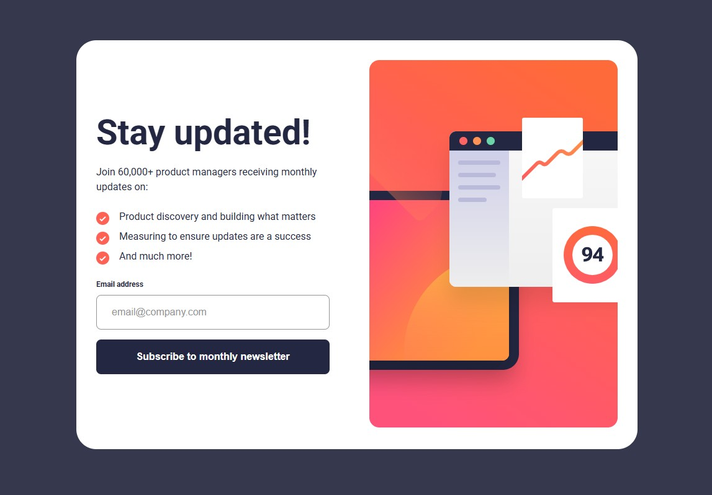

# Frontend Mentor - Newsletter sign-up form with success message

## Overview

For this challenge, I built and deployed Frontend Mentor's "Newsletter sign-up form with success message." This challenge required building a responsive form with an email input field that includes form submission, validation, error handling, and a success message. Frontend Mentor provided all the necessary assets, including images, a Figma file, and a comprehensive style guide.

[Frontend Mentor Newsletter sign-up form with success message challenge](https://www.frontendmentor.io/challenges/newsletter-signup-form-with-success-message-3FC1AZbNrv)

This challenge required knowledge of CSS, Flexbox, CSS Grid, JavaScript, semantic HTML, and responsive web design.

### Screenshot

### Links

- Solution URL: [github repository](https://github.com/ClassPython/fem-newsletter-signup-form)
- Live Site URL: [github-pages](https://classpython.github.io/fem-newsletter-signup-form/)

### Built with

- Semantic HTML5 markup
- CSS Flexbox
- CSS Grid
- JavaScript
- Mobile-first workflow

### What I learned

- Biggest challenges: 
	* Building a form with an email input field and submit button that were screen-reader-accessible.
	* Creating JavaScript event handlers and listeners to manage accessibility features across form submission, error handling, and the success message view.
- **Form accessibility:**  Used JavaScript, media queries, and CSS properties to toggle classes and attributes for targeted actions, forms, inputs, and screen views.
- **JavaScript event handlers and listeners:** Wrote JavaScript event listeners and handlers triggered by form clicks and field input events to dynamically update CSS classes and HTML attributes, ensuring form validation, submission, error handling, and screen views were both functional and screen-reader-friendly.
 
 ### Next Steps

- Complete the four remaining projects in Frontend Mentor's "JavaScript Fundamentals" learning path.
- Focus on building a project that emphasizes working with and managing JSON data.

